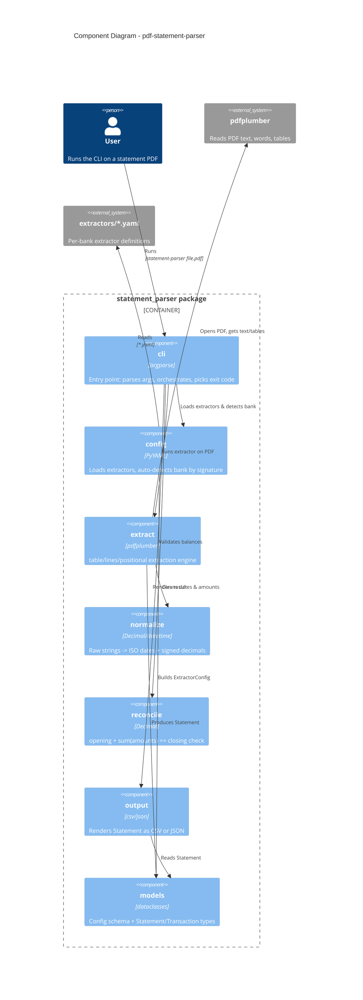

# Architecture — Component Diagram

How the `statement_parser` package is structured and how the pieces fit
together. This is the main "how the code works" view.

## What each module does

| Module | Responsibility |
|--------|---------------|
| `cli.py` | Parses CLI args, orchestrates the pipeline, chooses the exit code (0/1/2/3). |
| `config.py` | Discovers and loads `*.yaml` extractors; auto-detects the bank by matching each config's `match:` signature against the PDF text. |
| `models.py` | Dataclasses for the config schema (`ExtractorConfig`, `TransactionConfig`, `FieldConfig`, `NormalizationConfig`) and the output (`Statement`, `Transaction`). |
| `extract.py` | The engine. Uses pdfplumber to pull scalar fields (regex/bbox) and transactions (table, lines, or positional mode). Raises if zero rows after a match. |
| `normalize.py` | Converts raw strings to ISO dates and signed `Decimal` amounts per the bank's rules (separators, `£`/`$`, `CR`/`DR`, parentheses). |
| `reconcile.py` | Checks `opening + sum(amounts) == closing` when both balances are present. |
| `output.py` | Renders a `Statement` to CSV (ledger) or JSON (fields + ledger). |
