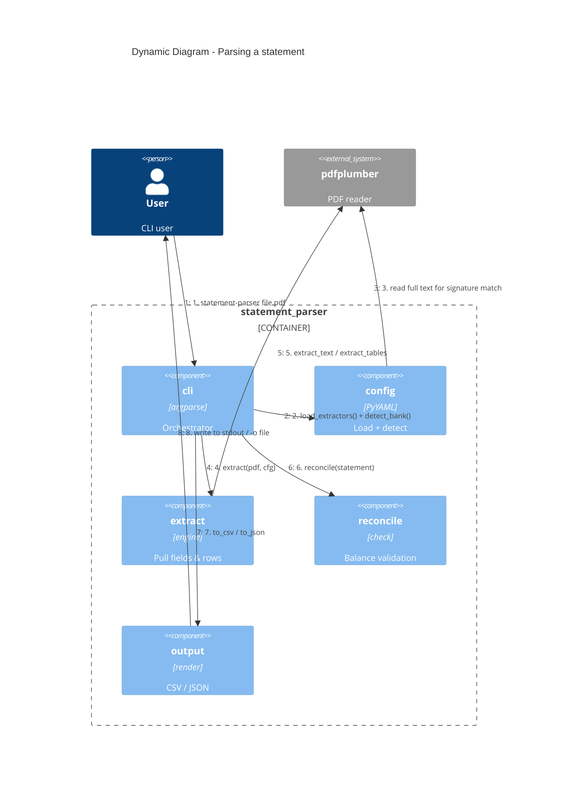

# Architecture — Runtime Flow

The end-to-end sequence when a user runs `statement-parser statement.pdf`.

## Step-by-step

1. User runs the CLI with a PDF path (optionally `--bank`, `--format`, `--strict`).
2. `cli` loads all extractor configs and, unless `--bank` is given, asks `config` to auto-detect the bank.
3. `config` reads the whole PDF's text via pdfplumber and matches it against each extractor's `match:` regex signatures. First match wins.
4. `cli` runs the matched extractor against the PDF.
5. `extract` uses pdfplumber to pull scalar fields (regex) and the transaction ledger (table or lines mode), normalizing dates and amounts as it goes.
6. `cli` runs balance reconciliation if opening & closing balances are present.
7. The `Statement` is rendered to CSV (default) or JSON.
8. Output goes to stdout or a file; the process exits 0/1/2/3 depending on outcome.

## Exit codes

| Code | Meaning |
|------|---------|
| 0 | Success |
| 1 | General error (bad file, malformed config, zero rows after a match) |
| 2 | No extractor matched the PDF |
| 3 | Reconciliation failed under `--strict` |
