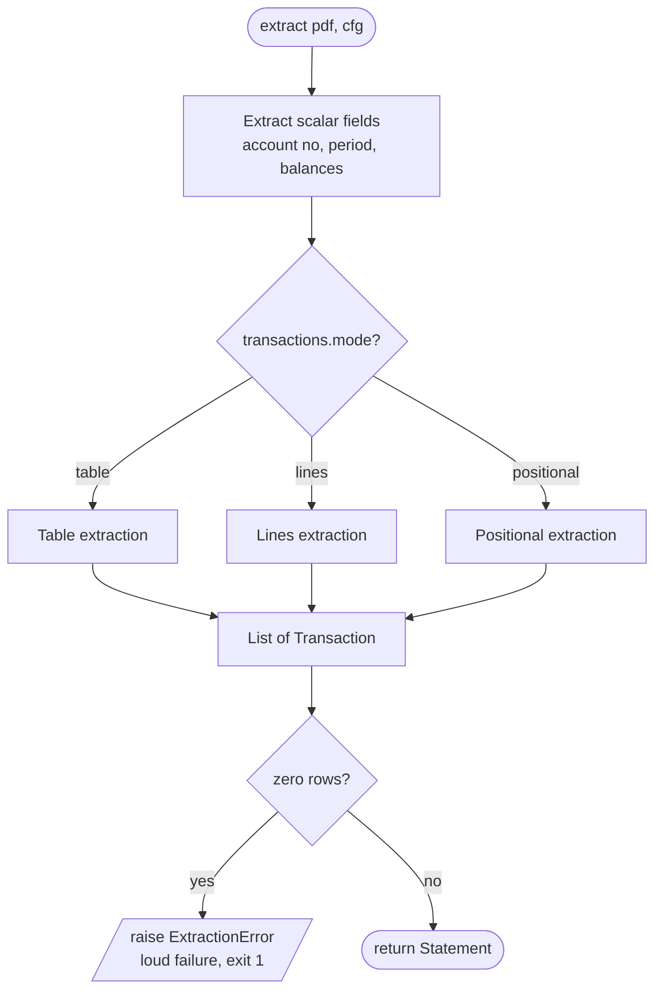
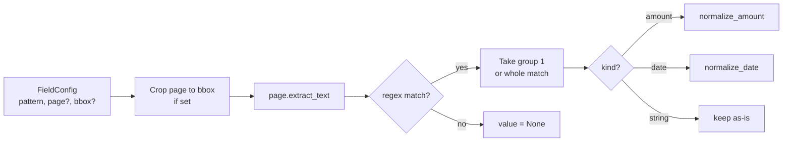
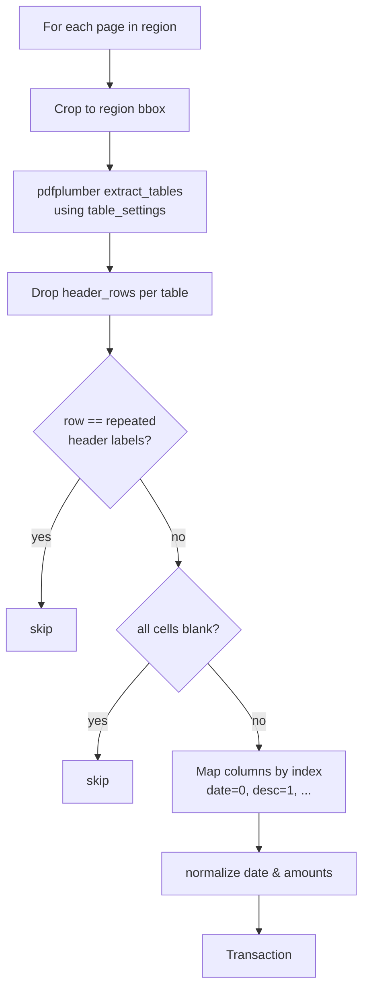
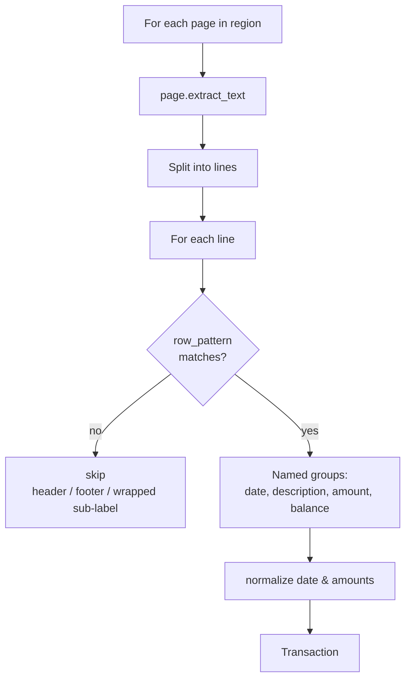
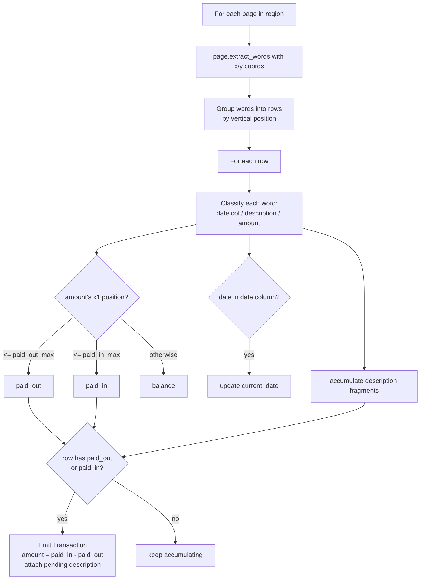
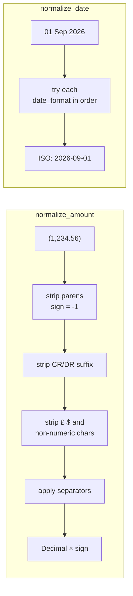

# Architecture — Extraction Engine Internals

The core logic: how `extract.py` turns a PDF + extractor config into a
`Statement`. This is where the two transaction modes (`table` and `lines`)
diverge.

## Overall extraction flow

## Scalar field extraction (both modes)

Each `fields:` entry is a regex (optionally scoped to a page/bbox). The first
capture group is the value; `kind: amount|date` triggers normalization.

## Table mode (ruled grids — e.g. Acme fixture)

## Lines mode (whitespace-aligned — e.g. Chase statements)

The lines mode is why Chase statements work: they have no usable grid lines, so
table detection fails, but each ledger row has a regular shape
(`DD Mon YYYY  description  ±£amount  £balance`) that a regex captures cleanly.
Wrapped description sub-labels (a second line reading "Transfer" or "Purchase")
simply don't match the full-row pattern and are skipped.

## Positional mode (separate debit/credit columns — e.g. HSBC)

The positional mode handles statements like HSBC Advance that have **separate
`Paid out` / `Paid in` / `Balance` columns** and no grid lines. Debit vs credit
is determined by an amount's horizontal position, not a sign. Descriptions span
multiple lines, so fragments accumulate until a row carries an amount, which
closes the transaction. `BALANCE BROUGHT/CARRIED FORWARD` marker rows are
skipped via `skip_rows_matching`.

## Normalization

